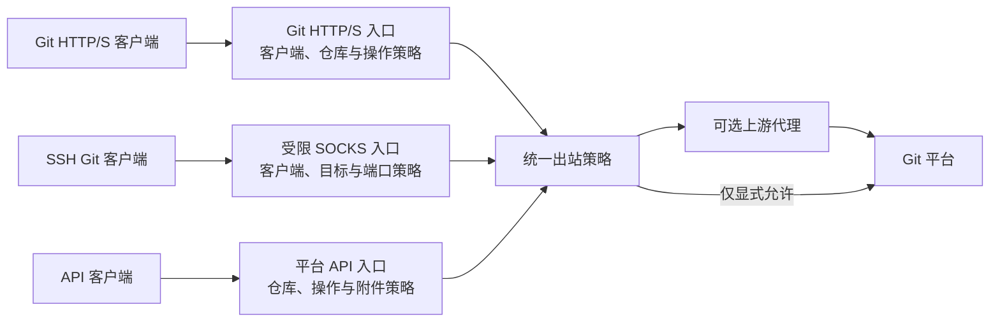

# 架构与安全边界

本文记录设计约定。首期 Rust 实现已完成，实际行为、使用方法及测试范围以 [运行文档](operations.md) 和 [验证记录](verification.md) 为准；下文的未来扩展建议不代表已实现功能。

## 1. 组件与流量

各入口共用配置、出站策略、服务生命周期与脱敏日志，按协议各自执行访问控制。仓库策略不能被误用于宣称限制 SSH 仓库。

## 2. Rust 模块划分建议

| 模块 | 职责 |
| --- | --- |
| 配置 | 类型化配置、环境变量读取、启动校验、脱敏摘要 |
| 策略 | 客户端 CIDR、平台目标、规范化仓库与操作授权 |
| 平台适配器 | 原生 Git/API 路径识别、操作映射、附件与跳转规则 |
| Git HTTP 入口 | Smart HTTP 请求识别、认证头转发、流式传输 |
| SOCKS 入口 | 仅开放必要的连接命令，校验来源及目标后双向转发 |
| API 入口 | API 路径与方法授权、受控重定向、附件传输 |
| 出站传输 | HTTP 代理与 SOCKS 连接、解析位置、超时、无回退规则 |
| 服务与观测 | 启停、优雅退出、健康检查、审计、计数与连接状态 |

使用 Rust 异步 I/O 处理双向流和大文件，保持背压，避免完整缓冲 pack 或 Release 附件。框架选择、并发上限、超时、缓冲上限应在实现时落实并记录。

## 3. HTTP 与 API 路由

单平台 Git 入口采用 `/owner/repo.git` 形式。API 与上传入口建议采用独立受控路径，例如 `/api/github/...` 和 `/uploads/github/...`，由平台适配器映射到固定上游。它们是设计候选，最终 CLI 使用方式在实现后记录。

客户端不得通过 URL、Host、请求头或查询参数自行选择任意上游。未来多平台可使用独立虚拟主机或显式平台前缀，保持平台路由无歧义。

授权流程：

1. 从可信连接信息识别客户端，校验来源白名单。默认不信任客户端提供的转发头；若置于反向代理之后，必须显式配置可信代理范围。
2. 严格解析并规范化路径；拒绝歧义编码、路径穿越、未知平台、未知方法和未知操作。
3. 解析仓库及操作，匹配明确的仓库策略；默认拒绝。
4. 从固定平台配置产生目标地址，再执行出站策略。

Git Smart HTTP 必须同时检查服务发现请求中的 `service` 和实际 RPC 路径。`git-upload-pack` 属于读取，`git-receive-pack` 属于写入；仅检查 GET/POST 无法区分仓库读写。tag 推送使用写入权限，不承诺逐引用策略。

平台身份认证继续由远端校验。转发必要的认证信息时使用 TLS，过滤逐跳头，避免认证头随跨目标重定向泄露。客户端输入与上游响应都不得使网关变成开放代理。

## 4. SSH 透明转发

SOCKS 入口仅承担受限 TCP 隧道，不终止 SSH、不持有用户 SSH 私钥、不替换用户公钥。来源、目标域名和端口必须全部匹配允许列表。

目标按规范化后的完整域名匹配，不使用宽泛后缀规则；IP 字面量、非允许域名和非允许端口默认拒绝。解析与连接必须使用经过策略校验的结果，避免解析变化访问内网或保留地址。代理端解析时网关无法直接验证远端解析结果，需固定允许的公开平台域名并信任上游代理。

客户端继续执行 SSH 主机密钥校验，不应通过禁用校验适配网关。

SSH 读写和仓库权限完全由平台决定。需要在验收中证明现有公钥能够正常认证，同时明确记录网关不能拒绝同一用户有权访问的其他 SSH 仓库。

## 5. Release 与附件

API 策略按仓库、规范化路径、HTTP 方法和操作共同判定；允许查询不隐含创建、更新、上传或删除权限。

附件域名白名单只解决目标范围，不等于仓库授权。必须从已授权仓库的 API/Release 路径建立附件归属，并在后续请求或重定向中保留该授权上下文。无法判断附件所属仓库的通用附件直链默认拒绝。

重定向逐跳校验协议、精确主机、端口和路径，限制跳数；拒绝降级到 HTTP、内网目标或未知目标。不同域名间默认不转发客户端认证头。API 返回的上传 URL、下载 URL 和跳转 Location 需要明确的网关映射规则，避免客户端绕开网关或将凭据发送到错误入口。

GitHub 实际 API 路径、附件目标及客户端兼容方式在实现前依据官方文档及受控请求验证，不能将本方案中的例子直接视为完整域名清单。

## 6. 代理环境变量约定

下列规则作为本项目计划实现的行为，不依赖所选 HTTP 库的默认语义：

| 场景 | 变量与行为 |
| --- | --- |
| HTTP 目标 | `HTTP_PROXY`，回退读取 `http_proxy` |
| HTTPS 目标 | `HTTPS_PROXY`，回退读取 `https_proxy`；不隐式继承 HTTP 代理 |
| SSH 隧道 | `ALL_PROXY`，回退读取 `all_proxy`，首期限定 SOCKS 上游 |
| HTTP(S)/API 绕过 | `NO_PROXY`，回退读取 `no_proxy` |

同名大小写变量都存在时，大写优先；大写为空视为显式未配置，不读取小写。非法代理 URL 在启动时报错，不当作缺省值处理。HTTP(S) 不隐式使用 `ALL_PROXY`。SSH 不隐式应用 `NO_PROXY`，避免意外改变隧道路由。

SOCKS 上游使用 `socks5://` 时由网关本地解析目标，使用 `socks5h://` 时交由上游解析。实现必须验证实际解析位置，不能仅修改 URL 协议名。

`NO_PROXY` 计划支持 `*`、精确域名、域名后缀、IP 和可选端口；具体语法需在实现时固定并通过边界测试，不能把 `example.com` 的匹配扩大到 `evil-example.com`。CIDR 是否支持在实现时明确。

无可用代理配置时，出站模式取 `direct` 或 `deny`，建议默认 `deny`。`NO_PROXY` 命中表示请求选择直连，但仍需出站模式显式允许直连；否则拒绝。此约束使默认拒绝模式不会因绕过列表而自动开放直连。

一旦选择代理，连接失败、认证失败或超时均返回错误，不重试直连。连接重试不得改变已选路由。状态可报告代理是否配置及路由类型，不输出完整代理 URL。

## 7. 服务与日志

启动时验证监听地址、白名单、目标规则、代理配置及 TLS 配置。不提供允许所有客户端或仓库的生产默认配置。

健康检查区分进程存活与服务就绪；上游探测需有超时和频率限制，状态输出不包含凭据。部署阶段提供服务管理示例并验证重启后使用正确配置。

日志采用允许字段集合，记录请求 ID、入口、策略结果、规范化仓库、操作、状态、耗时及脱敏错误。不得记录认证头、请求体、Token、完整查询字符串、附件签名 URL 或含凭据的代理 URL。错误链同样需要脱敏。

## 8. 控制台配置管理

管理入口使用独立密钥，不复用 GitHub Token。管理密钥通过私有文件或 GH_PROXY_ADMIN_TOKEN 提供，配置编辑与普通网关访问分权。管理 API 校验客户端来源、公开 Host、Bearer 密钥及写入 Origin，禁止任意文件路径或启动监听设置注入。

已校验的运行策略先写入同目录私有临时文件并同步，再原子替换配置，随后以共享快照发布。HTTP 每请求读取当前快照，SSH 每次接受连接读取快照；已建立流保持原快照。并发设置未变时复用同一许可池，修改上限时新连接按新许可池准入。保存版本冲突和检测到的外部文件修改拒绝覆盖，启动版本使用随机代次避免跨重启复用。

上游代理可在配置中显式覆盖环境变量；缺省继承，空值停用。对外读取移除代理凭据，未修改的脱敏地址保留旧凭据，显式清除操作不会保留。文件权限、热应用范围与启动配置边界见运行文档。
